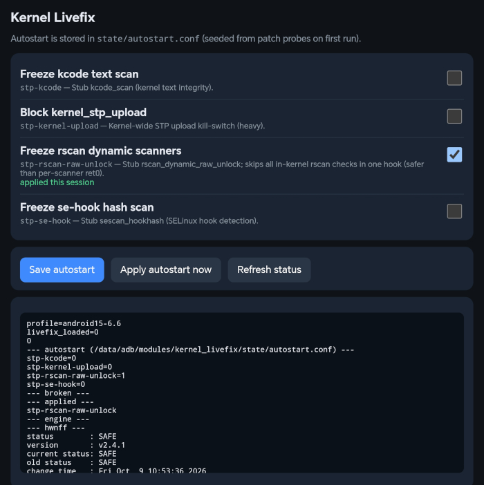

# Kernel Livefix (KernelSU module)

Kernel live patch engine to modify kernel functionality right on the fly.

Installs **`livefix.ko`** module, which you can `rmmod` while hooks with `persist=1` stay in kernel text until reboot.



## Build zip

```bash
cd kernelsu-modules/kernel-livefix

# All KMI profiles:
./build.sh

# Only GKI android15-6.6
KMI_PROFILES=android15-6.6 ./build.sh
```

## Install on device

Just use your su manager (like ReSukiSU/BakaSU/KernelSU) and soft-restart after installation - it
will automatically run the autostart patches if they are applicable to your device.

```bash
adb shell su -c 'sh /data/adb/modules/kernel_livefix/scripts/livefix-ctl.sh status'
```

## Additional docs

Architecture: [ARCHITECTURE.md](ARCHITECTURE.md)
Patches documentation: [patches/README.md](patches/README.md)
Shipped patch docs: `patches/src/*/README.md`
